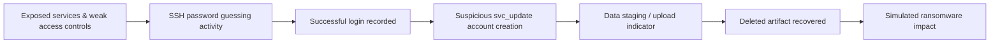
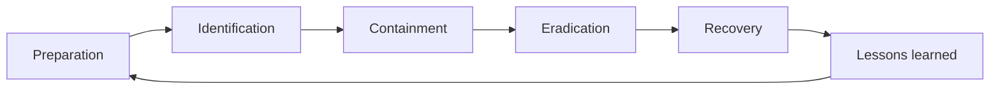

# BrightLeaf Organics | Security Assessment & Incident Review

> **Cybersecurity Capstone · Tekloomy Cyber Security & Ethical Hacking Internship · Day 20**  
> A lab-based security assessment that connects reconnaissance, detection, incident response, digital forensics, and risk prioritization into one incident narrative.

[](.) [](.) [](.)

---

## Executive summary

This capstone examines a simulated security incident at **BrightLeaf Organics**. The work follows the incident from exposed services and authentication weaknesses through suspicious account activity, evidence review, response planning, and business-risk prioritization.

The central lesson: **a security event is not just a technical problem—it can affect operations, customer trust, data confidentiality, and recovery readiness.** The recommended response focuses first on containing access, then hardening the environment, strengthening monitoring, and improving recovery and governance.

> This repository documents internship lab work and a simulated scenario. The IP address `203.0.113.77` is from a documentation-only range and is not attribution to a real attacker.


## Incident narrative



The lab evidence describes repeated SSH authentication failures targeting `admin`, followed by a successful login, creation of a suspicious `svc_update` account, data-staging/upload indicators, a deleted file recovered during forensic analysis, and a ransomware-impact scenario.

### Timeline highlights

| Time | Observed / simulated event | Why it matters |
|---|---|---|
| 02:14:06 | SSH brute-force activity begins in the lab log | Repeated failures may indicate password guessing |
| 02:16:13 | Successful SSH login recorded | Possible account compromise; validate context and source |
| 02:16:27 | `useradd` creates `svc_update` via sudo | Potential persistence / unauthorized account creation |
| Later | Staging and upload reference around 02:40; deleted artifact identified | Investigate possible data handling and evidence integrity |
| Scenario stage | Ransomware impact simulated | Test containment, recovery, and response readiness |

**Log-count note:** 65 failed SSH attempts were recorded in total; 60 were attributed in the lab log to the simulated source and 5 were described as internal typos. The successful login occurred about 127 seconds after the recorded brute-force start.

---
## Assessment workflow

| Internship lab | Work performed | Output / purpose |
|---|---|---|
| Day 12 · Reconnaissance | Nmap service discovery and exposure review | Identify attack surface and services requiring validation |
| Day 15 · Detection | Reviewed `auth.log`; interpreted authentication patterns and SIEM-style detection logic | Identify suspicious login activity and escalation indicators |
| Day 16 · Incident response | Applied PICERL incident-response lifecycle to simulated ransomware scenario | Organize containment, eradication, recovery, and lessons learned |
| Day 17 · Digital forensics | Evidence-image hash verification; Sleuth Kit file listing and file recovery workflow | Preserve integrity and recover a deleted artifact |
| Day 18 · Risk assessment | 5×5 likelihood × impact scoring and risk ownership | Rank risks, assign accountability, and prioritize remediation |

## Key findings

| Finding | Risk / business impact | Priority |
|---|---|---|
| Password-based SSH exposed to guessing | Unauthorized access and potential account compromise | **Critical** |
| Weak or reused credentials | Increases chance of compromise across accounts/services | **Critical** |
| Legacy / unpatched services and cleartext protocols | Larger attack surface; credentials or traffic may be exposed | **High** |
| Backup resilience gaps | Longer downtime and reduced recovery options after ransomware | **High** |
| Phishing and account lifecycle weaknesses | Initial access and dormant-account misuse | **High** |
| Monitoring and breach-readiness gaps | Delayed detection, response, and notification decisions | **High** |

*Risk labels reflect the project's lab-based assessment and prioritization—not a production penetration test or independently validated enterprise risk rating.*

## Forensics & evidence integrity

- **Evidence image SHA-256:** `92691f10ae992b9ec37a6a79e5088fc10e381ef540e797f391ba16eac19a1a3e`
- **Workflow:** hash verification → deleted-file discovery (`fls`) → targeted recovery (`icat`)
- **Recovered lab artifact:** `SECRET.TXT` / `_ECRET.TXT` (inode 5)
- **Lab recovery marker:** `FLAG{deleted_but_not_gone}`

The recovery demonstrates that deleting a file does not necessarily remove its contents from a forensic image. Recovery results should be interpreted alongside image integrity, file-system context, and other corroborating evidence.

## Risk treatment & remediation roadmap

### 0–48 hours · Contain and secure access
- Remove or disable the suspicious `svc_update` account after validating its purpose.
- Reset affected and privileged credentials; review SSH keys and authorized access.
- Restrict SSH exposure, enforce key-based authentication, and enable MFA where supported.
- Block or rate-limit the simulated source as appropriate; deploy brute-force protection such as Fail2Ban.
- Preserve relevant logs and evidence before making changes.

### Days 3–14 · Reduce attack surface and improve recovery
- Patch and validate exposed services; retire unnecessary legacy and cleartext services.
- Review service accounts, permissions, and remote-access rules.
- Implement tested backups using a 3-2-1 strategy with offline or immutable copies.
- Test restoration—not just backup creation—and document recovery objectives.

### Days 15–30 · Detect, govern, and practice
- Centralize authentication and security logs; alert on brute-force patterns, successful logins after repeated failures, privileged account creation, and unusual data movement.
- Improve onboarding/offboarding controls; promptly disable accounts when access is no longer required.
- Run phishing-awareness refreshers and incident-response exercises.
- Review incident communications, evidence handling, and applicable privacy/breach-notification obligations with responsible stakeholders.

## Incident response model



PICERL provides a repeatable structure for handling incidents. The capstone emphasizes preserving evidence, limiting attacker access, removing persistence, restoring systems safely, and using lessons learned to improve controls.

## Tools & techniques

- **Nmap** — service discovery and exposure assessment
- **Linux `auth.log`** — authentication event review
- **SIEM-style logic** — identify suspicious patterns and build detection ideas
- **PICERL** — incident-response workflow
- **Sleuth Kit (`fls`, `icat`)** — deleted-file discovery and recovery
- **`sha256sum` / SHA-256** — evidence integrity verification
- **5×5 risk matrix** — likelihood × impact scoring, risk ownership, and treatment

## Repository contents

```text
.
├── README.md
├── report/
│   └── BrightLeaf_Capstone_Report.pdf   # add final report here
├── presentation/
│   └── BrightLeaf_Capstone_Presentation.pptx
└── evidence/
    ├── nmap-scan.png                  # sanitized lab screenshot
    ├── auth-log.png                    # sanitized lab screenshot
    └── forensic-recovery.png            # sanitized lab screenshot
```

> Adjust the file names/folders above to match what you actually commit. Only include screenshots and documents that you have permission to publish; redact personal data, credentials, tokens, and unrelated system details.


## Project deliverables

- **Capstone report:** detailed assessment narrative, findings, and recommendations (add your final PDF/DOCX to `report/`).
- **Presentation:** briefing deck for a non-technical audience (add the final `.pptx` to `presentation/`).
- **Evidence screenshots:** sanitized supporting lab evidence (optional; add to `evidence/`).


## Scope & limitations

- This was a **simulated internship lab**, not an assessment of a real BrightLeaf Organics production network.
- Findings and attack sequence are based on the lab artifacts and scenario provided; they should not be treated as independently confirmed real-world compromise.
- The documentation IP `203.0.113.77` is not a real-world attacker address.
- Data-upload references are indicators in the scenario; this write-up does not claim independently verified exfiltration.
- Risk scores are qualitative lab estimates. Real-world risk should be revalidated with asset owners, business context, and evidence.

## What I learned

- Reconnaissance is most useful when findings are translated into actionable exposure and business risk.
- Authentication logs can tell a sequence—not just a count—when failure patterns, successful access, and privileged actions are correlated.
- Incident response needs evidence preservation and clear ownership as much as technical containment.
- Forensic recovery can surface artifacts that deletion alone does not reliably erase.
- A risk register turns technical findings into prioritized decisions, owners, and timelines.

## Disclaimer

This project is for educational and portfolio purposes. All testing was performed in an authorized, simulated lab environment. Do not use the techniques against systems without explicit permission.


---
### Author
**Cybersecurity & Ethical Hacking Internship Capstone** · Tekloomy · Day 20
